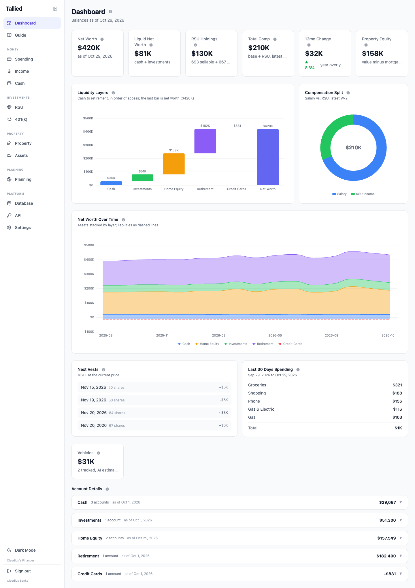

# Tallied

**Your finances, tallied.** One household's accounts, transactions, income, company stock, 401(k), house and vehicles in one PostgreSQL database you can also open with psql or a spreadsheet, with a dashboard that shows what it adds up to and a plan that projects it to retirement.

Tallied is a personal project, built for its owner's household. It is not a product. What it is, page by page, lives in [`docs/PRODUCT.md`](docs/PRODUCT.md); how it is built in [`docs/ARCHITECTURE.md`](docs/ARCHITECTURE.md); every requirement with its status and evidence in [`docs/requirements/ledger.yaml`](docs/requirements/ledger.yaml).



## What it does

- **Look**: Dashboard with net worth, liquid net worth, liquidity layers, compensation split, net worth over time, upcoming RSU vests and recent spending.
- **Feed**: bank and card sync through SimpleFIN; W-2, pay stub, mortgage, 401(k) and E-Trade RSU documents read by Claude and confirmed before anything is written; forwarded email receipts; manual entry.
- **Understand**: Spending, Income, Cash, RSU, 401(k), Property, Assets.
- **Plan**: year-by-year retirement projection with editable assumptions and scenario comparison.
- **Platform**: a database explorer with a read-only SQL runner, direct database credentials, API keys, the OpenAPI reference.

## Stack

FastAPI + SQLAlchemy 2.0 + Alembic on PostgreSQL 16 (schema per tenant), Vue 3 + TypeScript + Tailwind v4 + ECharts, Anthropic Claude for document extraction and labelled estimates.

## Run it locally

```bash
# Postgres 16 (Docker: make db-start; or Homebrew: brew services start postgresql@16)
cp backend/.env.example backend/.env       # set FINANCE_DEV_MODE=true, optionally FINANCE_ANTHROPIC_API_KEY
make install                               # backend venv + frontend node_modules
make seed-test                             # build the Claudius Banks demo tenant
make dev                                   # http://localhost:5173 (API on :8000)
```

Sign in as `claudius@tallied.dev` / `demo123`. The persona and its documents under `fixtures/` are the only data ever committed.

## Working on it

```bash
make test            # backend unit tests (SQLite)
make test-e2e        # backend e2e tests (Postgres + seed)
make typecheck       # vue-tsc
make test-frontend   # vitest
make tour            # screenshots of every route into artifacts/screens/
make ledger-check    # validate the requirements ledger
make pre-commit      # all of the above except e2e and tour; CI runs the same
```

Read [`docs/CONTRIBUTING-FEATURES.md`](docs/CONTRIBUTING-FEATURES.md) before adding anything: a requirement is done only with a test and, for anything visible, a screenshot from the tour. Deployment is described in [`docs/DEPLOYING.md`](docs/DEPLOYING.md).
